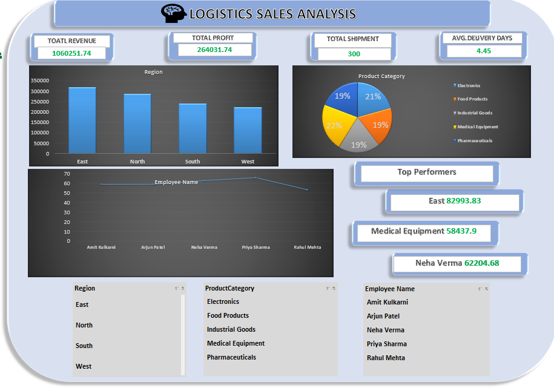

# Logistics Sales Analysis Dashboard \| Microsoft Excel

 **Transforming Logistics Data into Meaningful Business Insights
 Through Interactive Excel Analytics.**

------------------------------------------------------------------------

## Project Overview

The **Logistics Sales Analysis Dashboard** is an interactive business
intelligence project developed using Microsoft Excel to analyze sales
performance, profitability, shipment volume, regional performance,
product categories, employee performance, and delivery efficiency.
The dashboard converts raw logistics data into meaningful business
insights through KPI tracking, data analysis, charts, and interactive
filtering.

**Project Domain:** Logistics & Supply Chain Analytics\
**Tool:** Microsoft Excel\
**Project Type:** Data Analytics & Business Intelligence\
**Dashboard:** Interactive Excel Dashboard

------------------------------------------------------------------------

## Dashboard Preview

The following image represents the Excel dashboard developed for this
project.



### Dashboard Components

- Executive KPI Cards
- Regional Sales Analysis
- Product Category Analysis
- Employee Performance Analysis
- Top Performer Identification
- Interactive Data Filters

------------------------------------------------------------------------

## Business Problem

Logistics organizations generate large volumes of sales and shipment
data. Analyzing this information manually can make it difficult to
monitor business performance and identify improvement opportunities.

This dashboard helps answer important business questions:

- Which region generates the highest revenue?
- What is the overall business profitability?
- How many shipments are processed?
- What is the average delivery time?
- Which product category contributes the most?
- Which employee demonstrates the strongest performance?
- Where can management improve operational efficiency?

------------------------------------------------------------------------

## Project Objectives

- Analyze overall sales and revenue performance.
- Monitor total profit and shipment volume.
- Compare regional sales performance.
- Identify high-performing product categories.
- Evaluate employee-level performance.
- Monitor average delivery time.
- Create an interactive dashboard for management reporting.
- Generate meaningful business insights from logistics data.

------------------------------------------------------------------------

## Key Performance Indicators (KPIs)

  KPI                               Value
  ----------------------- ---------------
  Total Revenue             10,060,251.74
  Total Profit                 264,031.74
  Total Shipments                     300
  Average Delivery Days              4.45

### Top Performers

  Performance Category   Top Performer             Value
  ---------------------- ------------------- -----------
  Region                 East                  82,993.83
  Product Category       Medical Equipment     58,437.90
  Employee               Neha Verma            62,204.68

*Note: Values above are transcribed from the dashboard screenshot.
Verify them against the final Excel workbook before publishing.*

------------------------------------------------------------------------

## Dashboard Analysis

### 1. Regional Sales Analysis

Analyzes revenue performance across four regions:

- East
- North
- South
- West

**Key Insight:** The East region is the leading revenue contributor in
the displayed dashboard.

**Business Value:** Helps management compare regional performance and
identify opportunities to improve sales in other regions.

### 2. Product Category Analysis

Analyzes business contribution across five product categories:

- Electronics
- Food Products
- Industrial Goods
- Medical Equipment
- Pharmaceuticals

**Key Insight:** Medical Equipment is highlighted as the leading product
category in the dashboard.

**Business Value:** Supports product-level sales analysis, inventory
planning, and business prioritization.

### 3. Employee Performance Analysis

Compares the performance of five employees:

- Amit Kulkarni
- Arjun Patel
- Neha Verma
- Priya Sharma
- Rahul Mehta

**Key Insight:** Neha Verma is highlighted as the top employee in the
dashboard.

**Business Value:** Helps management evaluate employee performance and
identify opportunities for improvement.

### 4. Delivery Performance Analysis

Monitors average delivery duration across logistics operations.

**Key Insight:** The average delivery time is 4.45 days.

**Business Value:** Helps management monitor delivery efficiency and
identify opportunities to improve logistics operations.

------------------------------------------------------------------------

## Key Business Insights

  Analysis               Business Insight
  ---------------------- ------------------------------------------------
  Revenue                Total revenue is approximately 10.06 million.
  Profit                 Total profit is approximately 264 thousand.
  Shipments              300 total shipments are recorded.
  Regional Performance   East is the leading region.
  Product Performance    Medical Equipment is the highlighted category.
  Employee Performance   Neha Verma is the highlighted employee.
  Delivery Performance   Average delivery time is 4.45 days.

### Business Recommendations

- Analyze successful regional sales strategies.
- Focus on high-performing product categories.
- Monitor employee performance regularly.
- Track delivery timelines to improve operational efficiency.
- Monitor revenue and profit together.
- Use interactive filters for detailed business analysis.

------------------------------------------------------------------------

## Tools & Technologies

  Tool / Feature      Application
  ------------------- -----------------------------------------
  Microsoft Excel     Data analysis and dashboard development
  Excel Formulas      Calculations and KPI development
  Pivot Tables        Data summarization and comparison
  Excel Charts        Visual representation of business data
  Slicers / Filters   Interactive data exploration
  Data Cleaning       Data quality and consistency
  KPI Cards           Performance monitoring
  Dashboard Design    Business reporting and visualization

------------------------------------------------------------------------

## Excel Skills Demonstrated

### Data Analytics Skills

- Data Cleaning
- Data Validation
- Exploratory Data Analysis (EDA)
- Data Summarization
- KPI Calculation
- Business Analysis
- Performance Monitoring
- Insight Generation

### Microsoft Excel Skills

- Excel Formulas and Functions
- Pivot Table Analysis
- Data Filtering
- Interactive Dashboard Development
- Chart Creation
- Data Visualization
- KPI Dashboard Design
- Management Reporting

### Professional Skills

- Analytical Thinking
- Problem Solving
- Business Understanding
- Decision Support
- Data Interpretation
- Attention to Detail

------------------------------------------------------------------------

## Project Workflow

``` text
       Raw Logistics Data
               |
               v
      Data Cleaning
               |
               v
      Data Validation
               |
               v
       Data Analysis
               |
               v
       KPI Calculation
               |
               v
      Pivot Table Analysis
               |
               v
       Chart Development
               |
               v
    Interactive Dashboard
               |
               v
       Business Insights
               |
               v
   Management Decision Support
```

------------------------------------------------------------------------

## Project Structure

``` text
Logistic-Sales-Analysis/
|
|-- Asset/
|   |-- Home_page.png
|
|-- 01_Raw_Data/
|   |-- logistics_data.xlsx
|
|-- 02_Excel_Dashboard/
|   |-- Logistics_Sales_Analysis_Dashboard.xlsx
|
|-- 03_Documentation/
|   |-- Business_Insights.txt
|
|-- README.md
```

------------------------------------------------------------------------

## Business Value

This project demonstrates how Microsoft Excel can transform raw
logistics data into actionable business information.

It helps organizations:

- Monitor sales and profitability.
- Analyze regional performance.
- Identify high-performing products.
- Evaluate employee contributions.
- Monitor shipment volume.
- Track delivery efficiency.
- Improve management reporting.
- Support data-driven decisions.

------------------------------------------------------------------------

## Future Enhancements

The project can be extended with additional analytical capabilities:

- Monthly and Quarterly Sales Trends
- Year-over-Year Growth Analysis
- Profit Margin Percentage
- Revenue per Shipment
- Cost per Shipment
- On-Time Delivery Percentage
- Delayed Shipment Analysis
- Target vs. Actual Performance
- Customer Segmentation
- Power BI Dashboard
- SQL-Based Data Analysis

------------------------------------------------------------------------

## Career Relevance

This project demonstrates practical Microsoft Excel and data analytics
skills relevant to the following job roles:

- Data Analyst
- MIS Executive
- MIS Analyst
- Business Analyst
- Reporting Analyst
- Operations Analyst
- Business Intelligence Analyst

**Key Skills:** Microsoft Excel \| Data Cleaning \| Data Analysis \|
Pivot Tables \| KPI Reporting \| Data Visualization \| Dashboard
Development \| Business Intelligence

------------------------------------------------------------------------

## Project Information

  Category           Details
  ------------------ ------------------------------------
  Project Name       Logistics Sales Analysis Dashboard
  Domain             Logistics & Supply Chain
  Technology         Microsoft Excel
  Project Category   Data Analytics
  Dashboard Type     Interactive Dashboard
  Main Focus         Sales & Operational Performance
  Project Status     Completed

------------------------------------------------------------------------

## Author

**Rohini Bhaje**

Aspiring Data Analyst \| Microsoft Excel Dashboard Developer

 Email: <bhajerohini@gmail.com>

🔗 GitHub: [Rohini Bhaje](https://github.com/Rohinibhaje69-cloud)

------------------------------------------------------------------------
